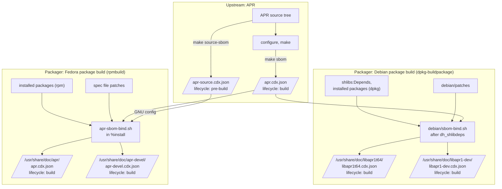

# SBOMs from upstream to packages: an APR experiment

This fork of the [Apache Portable Runtime](https://apr.apache.org/) (APR) explores
how an upstream project and the distributions packaging it
can produce and share Software Bills of Materials (SBOMs).

The idea is that the SBOM is written once, where the knowledge is:

- **Upstream** knows what is in its sources (third-party code, licenses, copyrights)
  and which libraries a build links against.
  APR's build system generates [CycloneDX 1.7](https://cyclonedx.org/) SBOMs from that knowledge.
- **Packagers** know which packages provide those libraries in their distribution,
  and which patches they apply.
  Instead of producing an SBOM from scratch,
  they take the upstream build SBOM and *bind* it to their packages.

For now Debian and Fedora are implemented.

This is an experiment, not an official Apache APR, Debian or Fedora release.

## Branches

| Branch                                                                         | Content                                                                                                                                                                                                 |
|--------------------------------------------------------------------------------|---------------------------------------------------------------------------------------------------------------------------------------------------------------------------------------------------------|
| `sbom-demo`                                                                    | This README, the Dockerfiles of the build environments, and [example SBOMs](examples).                                                                                                                  |
| [`asf/sbom-1.7.x`](https://github.com/ppkarwasz/apr/tree/asf/sbom-1.7.x)       | APR 1.7.x with REUSE compliance and SBOM generation (upstream side).                                                                                                                                    |
| [`debian/sbom-1.7.x`](https://github.com/ppkarwasz/apr/tree/debian/sbom-1.7.x) | The Debian packaging of APR (from [salsa.debian.org/apache-team/apr](https://salsa.debian.org/apache-team/apr)), building `asf/sbom-1.7.x` and shipping an SBOM in each binary package (packager side). |
| [`fedora/sbom-1.7.x`](https://github.com/ppkarwasz/apr/tree/fedora/sbom-1.7.x) | The Fedora packaging of APR (from [src.fedoraproject.org/rpms/apr](https://src.fedoraproject.org/rpms/apr)), building `asf/sbom-1.7.x` and shipping an SBOM in each binary package (packager side).     |

`asf/sbom-1.7.x` adds three commits to APR's 1.7.x branch:

1. **REUSE compliance**:
   copyright and licensing information for every file,
   following the [REUSE specification](https://reuse.software/).
   Third-party code carries `SPDX-License-Identifier` and `SPDX-FileCopyrightText` tags next to its original notice,
   or `SPDX-SnippetBegin`/`SPDX-SnippetEnd` tags around the parts of a file it occupies;
   `REUSE.toml` covers everything else,
   and `LICENSES/` holds the license texts.
2. A `.gitignore`, backported from APR 1.8.x.
3. **SBOM generation**:
   `make source-sbom` and `make sbom`,
   implemented by `build/sbom.sh` (POSIX shell and [jq](https://jqlang.org/))
   with the data in `build/sbom/components.json`.

`debian/sbom-1.7.x` merges `asf/sbom-1.7.x` directly,
so its history contains the upstream commits.

`fedora/sbom-1.7.x` is a dist-git branch (spec file and patches):
it builds a snapshot of `asf/sbom-1.7.x`,
downloaded as GitHub's archive of the commit.

## How it works



### Upstream: the source SBOM

`make source-sbom` describes the source tree, mostly for license compliance:

- every piece of third-party code in APR,
  with its license and copyright read from the SPDX tags,
  and the files (or line ranges, for snippets) where it occurs;
- the build tools copied into the tree
  (GNU config, an Autoconf Archive macro, and in release tarballs the libtool files and `configure`);
- every library the UNIX build may link against,
  as an external component (`isExternal: true`)
  with the range of versions accepted (`versionRange`).

The generator checks the source tree against `build/sbom/components.json`:
it fails if a file carries a license tag other than Apache-2.0 that no component accounts for,
so newly added third-party code cannot go unnoticed.

### Upstream: the build SBOM

`make sbom` describes one build of `libapr`:

- the libraries it needs at run time,
  read from the `DT_NEEDED` entries of the built shared library,
  with the versions found on the build system
  and the files they resolved to (e.g. `/usr/lib/x86_64-linux-gnu/libuuid.so.1`);
- the third-party code compiled in,
  but only code from a **maintained** upstream whose advisories could apply.
  Code forked from 4.4BSD or UNIX V7 decades ago is marked `historical` in `components.json`:
  it matters for license compliance, so it stays in the source SBOM,
  but would only add noise to vulnerability matching.

### Packager: binding the build SBOM to Debian packages

`debian/sbom-bind.sh` runs during the package build, after `dh_shlibdeps`,
and derives the SBOM of each binary package from the upstream build SBOM:

- `metadata.component` becomes the Debian package (`pkg:deb/debian/libapr1t64@…`);
  the upstream component becomes its pedigree ancestor,
  and `debian/patches` its patches;
- each external library is bound to the Debian package owning the file it resolved to (`dpkg -S`),
  with the version range taken from `shlibs:Depends` (e.g. `libc6`, `vers:deb/>=2.38`);
- the bundled code is copied unchanged.

The result is shipped in `/usr/share/doc/<package>/<package>.cdx.json`.

### Packager: binding the build SBOM to Fedora packages

`apr-sbom-bind.sh` runs in the `%install` section of the spec file
and derives the SBOM of each binary package the same way:

- `metadata.component` becomes the Fedora package (`pkg:rpm/fedora/apr@…?arch=x86_64&distro=fedora-46`);
  the upstream component becomes its pedigree ancestor,
  and the patches of the spec file its patches;
- each external library is bound to the RPM package owning the file it resolved to (`rpm -qf`),
  with the exact version built against (e.g. `glibc`, `2.44.9000-6.fc46`):
  RPM has no equivalent of Debian's versioned `shlibs`,
  and its automatic dependencies are only computed after `%install`;
- for `apr-devel`, which ships `config.guess` and `config.sub`,
  the GNU config component is taken from the upstream source SBOM.
  Fedora's `%configure` replaces both files with its own copies,
  so the component records the version actually shipped.

The result is shipped in `%{_docdir}/<package>/<package>.cdx.json`.

### Reproducibility

The SBOMs are reproducible:
the timestamp comes from `SOURCE_DATE_EPOCH`,
the serial number is a version 5 UUID derived from the package URL,
the scripts run with `LC_ALL=C`,
and build paths are recorded as `@abs_builddir@` and `@abs_srcdir@`.

## Examples

The [`examples`](examples) directory contains SBOMs generated by the commands below:

| File                                                              | Description                                                           |
|-------------------------------------------------------------------|-----------------------------------------------------------------------|
| [`apr-source.cdx.json`](examples/apr-source.cdx.json)             | Source SBOM of `asf/sbom-1.7.x`, the same in both build environments. |
| [`debian/build/apr.cdx.json`](examples/debian/build/apr.cdx.json) | Upstream build SBOM, from the Debian package build (Debian sid).      |
| [`debian/packages/`](examples/debian/packages)                    | SBOMs of the `libapr1t64` and `libapr1-dev` packages.                 |
| [`fedora/build/apr.cdx.json`](examples/fedora/build/apr.cdx.json) | Upstream build SBOM, from the Fedora package build (Fedora rawhide).  |
| [`fedora/packages/`](examples/fedora/packages)                    | SBOMs of the `apr` and `apr-devel` packages.                          |

The source SBOM was generated from the git tree, before `buildconf`,
with `SOURCE_DATE_EPOCH` set to the commit time;
after `buildconf`, it would also describe the `configure` script and libtool files of the build environment.

## Try it

You need git and Docker.

Clone this fork and check out the three code branches as worktrees next to this README:

```sh
git clone -b sbom-demo https://github.com/ppkarwasz/apr.git apr-sbom
cd apr-sbom
git worktree add apr asf/sbom-1.7.x
git worktree add apr-debian debian/sbom-1.7.x
git worktree add apr-fedora fedora/sbom-1.7.x
```

Build the images with the build environments:
Debian sid (with APR's build dependencies, jq, lintian and reuse)
and Fedora rawhide (with rpm-build and APR's build dependencies).
`UID` and `GID` make the files written by the containers yours:

```sh
docker build -f Dockerfile.debian -t apr-debian-build --build-arg UID="$(id -u)" --build-arg GID="$(id -g)" .
docker build -f Dockerfile.fedora -t apr-fedora-build --build-arg UID="$(id -u)" --build-arg GID="$(id -g)" .
```

### Upstream SBOMs

Build APR outside its source tree and generate both SBOMs into `out/`, in either image:

```sh
mkdir -p out
docker run --rm -v "$PWD/apr":/src:ro -v "$PWD/out":/out apr-debian-build sh -ec '
    cp -a /src /tmp/apr && cd /tmp/apr && ./buildconf
    chmod -R a-w /tmp/apr
    mkdir /tmp/build && cd /tmp/build && /tmp/apr/configure
    make -j"$(nproc)" && make sbom source-sbom
    cp apr.cdx.json apr-source.cdx.json /out/'
```

The source tree is mounted read-only,
and the copy is write-protected after `buildconf`,
which also checks that the build does not write into the sources.

### Debian packages

```sh
docker run --rm -v "$PWD":/work -w /work/apr-debian -e DEB_BUILD_OPTIONS=nocheck \
    apr-debian-build dpkg-buildpackage -us -uc -b
```

The packages are written to this directory.
Extract an SBOM with:

```sh
dpkg-deb --fsys-tarfile libapr1t64_*.deb \
    | tar -xO ./usr/share/doc/libapr1t64/libapr1t64.cdx.json | jq .
```

Clean the Debian tree afterwards with:

```sh
docker run --rm -v "$PWD":/work -w /work/apr-debian apr-debian-build fakeroot debian/rules clean
```

### Fedora packages

```sh
mkdir -p rpms
docker run --rm -v "$PWD/apr-fedora":/src:ro -v "$PWD/rpms":/out apr-fedora-build sh -ec '
    mkdir -p ~/rpmbuild/SOURCES && cp -a /src/. ~/rpmbuild/SOURCES/ && cd ~/rpmbuild/SOURCES
    spectool -g apr.spec
    rpmbuild -ba --define "_sourcedir $PWD" apr.spec
    cp ~/rpmbuild/RPMS/*/*.rpm ~/rpmbuild/SRPMS/*.rpm /out/'
```

`spectool` downloads the snapshot of `asf/sbom-1.7.x` from GitHub,
and `%check` runs APR's test suite.
The packages are written to `rpms/`.
Extract an SBOM with:

```sh
docker run --rm -v "$PWD/rpms":/rpms apr-fedora-build sh -c \
    'rpm2cpio /rpms/apr-1.*.x86_64.rpm | cpio -i --quiet --to-stdout ./usr/share/doc/apr/apr.cdx.json' | jq .
```

### Checks

```sh
docker run --rm -v "$PWD/apr":/src -w /src apr-debian-build reuse lint
docker run --rm -v "$PWD":/work -w /work apr-debian-build lintian -I *.changes
```

The SBOMs can be validated against the CycloneDX 1.7 schema,
for example with [CycloneDX CLI](https://github.com/CycloneDX/cyclonedx-cli):
`cyclonedx validate --input-file apr.cdx.json --input-version v1_7`.

## Status and open questions

- Only the UNIX build of APR and only Debian and Fedora packaging are covered.
- Release tarballs contain files generated by `buildconf` (`configure`, libtool's files),
  whose license texts are not in `LICENSES/`:
  REUSE rejects unused licenses in the git tree,
  so the release process would have to add them.
- The upstream version ranges are `vers:generic/*`,
  because APR's configure script checks no minimum versions.
- Debian packages record version ranges for their dependencies,
  Fedora packages the exact versions built against.
  Could RPM provide minimum versions, e.g. from the symbol versions of glibc?
- Neither Debian nor Fedora has a convention yet for where a package ships its SBOM.
- The `License:` field of Fedora's spec file and its comment are maintained by hand;
  they could be derived from the upstream REUSE data,
  and checked against it.
- Should SBOMs embed the full text of the distribution patches, or only reference them?
- Each distribution has its own binding script;
  they could become a single tool shared by packagers.
- On APR 1.8.x, the vendored [cryptoint](https://lib.mceliece.org/) code
  is the only third-party code with a maintained upstream;
  it has no package URL or CPE to match advisories against.

## License

The content of this branch is licensed under the Apache License, Version 2.0, like APR itself.
